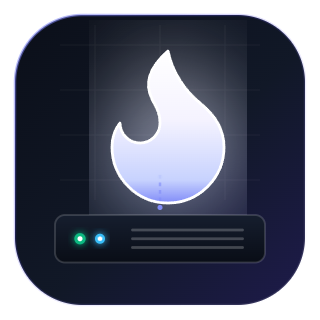

# Ignite Music - Desktop Companion Launcher & Supervisor

<p align="center">
  
</p>

<p align="center">
  <strong>Native desktop supervisor, tunnel orchestrator, and lifecycle manager for Ignite Music</strong><br>
  <em>Engineered with Electron to eliminate external dependencies and provide a zero-config, plug-and-play experience.</em>
</p>

<p align="center">
  
  
  
  
</p>

---

## 📖 Overview

**Ignite Music Desktop** is the official desktop companion client designed to execute, monitor, and maintain the [`ignite-music`](https://github.com/DeibydBarragan/ignite-music) bot service.

Unlike traditional server setups that demand installing Node.js, compiling native C++ audio dependencies, and handling command-line flags, this companion launcher packages a sandboxed, hardened Electron runtime allowing any user or administrator to:
- Start, stop, and restart the bot process with a single click.
- Encrypt tokens and sensitive secrets using hardware-backed OS credentials (`safeStorage`).
- Control administrative access via local Discord OAuth2 with server verification (**Gatekeeper**).
- Expose the REST API to the Internet via Cloudflare Quick Tunnels without manual port-forwarding.
- Keep audio extractors (`yt-dlp`) up-to-date against streaming platform changes without reinstalling the application.

---

## 🚀 Key Features

| Feature | Technical Specification |
| :--- | :--- |
| **Zero-Config Runtime** | Requires zero external Node.js installation; operates with the self-contained Electron runtime. |
| **Enterprise Security** | Hardened renderer with `contextIsolation: true`, `nodeIntegration: false`, `sandbox: true`, and a strict IPC channel whitelist. |
| **Encrypted Storage** | Discord bot tokens and API secrets are encrypted at rest using native OS cryptographic APIs (`DPAPI` on Windows, `Secret Service` on Linux). |
| **Discord Gatekeeper** | Local loopback HTTP server (`127.0.0.1:0/callback`) for OAuth2. Validates guild membership and administrator permissions directly against Discord's REST API. |
| **Real-time ANSI Terminal** | Streams `stdout`/`stderr` with ANSI escape sequence formatting, capped memory buffer (1,000 lines), smart auto-scroll, and log-level filtering. |
| **Cloudflare Quick Tunnel** | Embedded `cloudflared` binary; automatically intercepts public `https://*.trycloudflare.com` URLs with one-click clipboard copy. |
| **OTA Update Engine** | Asynchronous GitHub Releases querying, SemVer comparison, atomic file extraction, and **automatic rollback** on startup failure. |
| **yt-dlp Maintenance** | Independent one-click binary updater for YouTube audio extractors without touching the desktop app binaries. |
| **System Tray** | Minimizes to Windows notification area on window close (**X**), complete with a native context menu and single-instance locking. |

---

## 📥 End-User Guide

### 1. Windows Installation
1. Download the latest **`Ignite Music-Setup-1.0.0.exe`** installer from the GitHub **Releases** page.
2. Run the executable and follow the NSIS installation wizard steps.
3. Choose the target destination directory and configure Desktop / Start Menu shortcut preferences.
4. On the finish screen, keep the checkbox checked to launch **Ignite Music** immediately.

### 2. Initial Setup (First Boot)
When launched for the first time, the configuration modal opens automatically:
1. **Discord Bot Token**: Paste your bot token from the [Discord Developer Portal](https://discord.com/developers/applications).
2. **Client ID**: Copy the *Application ID* of your Discord application.
3. **Guild ID**: Numeric snowflake ID of the Discord server where the bot operates.
4. **Client Secret**: Client secret of your application (required for the local OAuth2 handshake).
5. **API Secret**: Click **[Generate]** to create a high-entropy 64-character hex secret that safeguards your local REST endpoints.
6. Click **Save Credentials**. All keys are immediately encrypted on disk.

### 3. Authentication & Verification (Gatekeeper)
1. Click **Log In with Discord**.
2. Your default web browser will open to request identity authorization (`identify` scope).
3. The launcher intercepts the OAuth2 code on a local ephemeral loopback port and verifies against Discord:
   - **Authorized member**: Unlocks the dashboard, service controls, and live log stream.
   - **Non-member**: Displays an Access Denied screen indicating that the logged-in Discord account is not present in the target guild, with options to retry or switch accounts.

---

## 🛠 Developer Guide & Scripts

### Prerequisites
- Node.js 22.x LTS installed (only required for local development and compilation).
- npm or compatible package manager.

### Available Scripts

```bash
# Launch the application in development mode with live reload
npm start

# Run the automated unit test suite (23 native tests)
npm test

# Package the application into an unpacked portable directory (dist/win-unpacked)
npm run pack

# Build the complete Windows NSIS executable installer (.exe)
npm run dist:win

# Build the portable Linux package (.AppImage)
npm run dist:linux
```

---

## 🏛 Project Architecture

```text
ignite-music-desktop/
├── .github/workflows/    # CI/CD automated release pipeline
│   └── build-desktop.yml # Multi-platform installer compilation on git tags
├── build/                # High-resolution application and installer icons (.ico, .png)
├── resources/            # Embedded auxiliary runtime binaries (cloudflared, yt-dlp)
│   └── bin/
│       └── cloudflared.exe
├── src/
│   ├── main/             # Main Process (Supervisors and native OS integrations)
│   │   ├── index.js              # Application lifecycle and single-instance lock
│   │   ├── config-manager.js     # safeStorage encrypted credential persistence
│   │   ├── config-schema.js      # Configuration validation schema and hex entropy generator
│   │   ├── auth-manager.js       # Ephemeral HTTP loopback Discord OAuth2 flow
│   │   ├── gatekeeper.js         # Discord REST guild membership validator
│   │   ├── process-supervisor.js # Child process fork supervisor and graceful shutdown
│   │   ├── tunnel-supervisor.js  # cloudflared process manager and URL regex extractor
│   │   ├── updater-engine.js     # SemVer engine, GitHub Releases client, and rollback
│   │   ├── tray-manager.js       # System tray icon, notifications, and context menu
│   │   └── ipc-handlers.js       # Whitelisted IPC message bus dispatcher
│   ├── preload/          # Secure contextBridge interface
│   │   └── index.js              # Whitelisted window.igniteLauncher API
│   └── renderer/         # Presentation Layer (HTML5 / Vanilla ES Modules)
│       ├── index.html            # Main markup shell
│       ├── css/app.css           # Modern dark theme stylesheet
│       └── js/                   # Modular UI components (< 150 lines per module)
│           ├── app.js            # Frontend orchestrator and entry point
│           ├── auth-view.js      # Authentication and Access Denied state machine
│           ├── log-viewer.js     # Real-time ANSI terminal renderer and auto-scroll
│           ├── service-controls.js # Start, stop, restart triggers and uptime timer
│           ├── settings-modal.js # Credential inputs and key generator
│           ├── tunnel-card.js    # Cloudflare status card with copyable URL
│           └── update-banner.js  # Version notification and yt-dlp updater trigger
├── test/                 # Test suites (node:test)
├── electron-builder.yml  # Packaging configuration for NSIS and AppImage
└── package.json          # Project manifest and Electron dependencies
```

---

## ❓ Troubleshooting & FAQ

### 1. Why doesn't the application close when clicking the "X" button?
The application is configured to minimize to the Windows notification tray area (next to the taskbar clock) so that the bot service remains uninterrupted. To close the application completely, right-click the flame icon in the System Tray and select **"Exit Ignite Music"**.

### 2. What should I do if YouTube blocks audio playback?
You do not need to reinstall or update the whole desktop application. Navigate to **⚙️ Settings**, scroll to the *Maintenance and Extractors* section, and click **⚡ Update yt-dlp**. The latest extractor will be downloaded in seconds.

### 3. The interface shows "Access Denied"
Verify the following:
1. You logged in with the intended Discord user account.
2. The bot is actively joined to the Discord server specified by `GUILD_ID` in your settings.
3. Your Discord account is a current member of that server.

---

## 📄 License

Distributed under the **MIT** license. Developed by [DeibydBarragan](https://github.com/DeibydBarragan).
